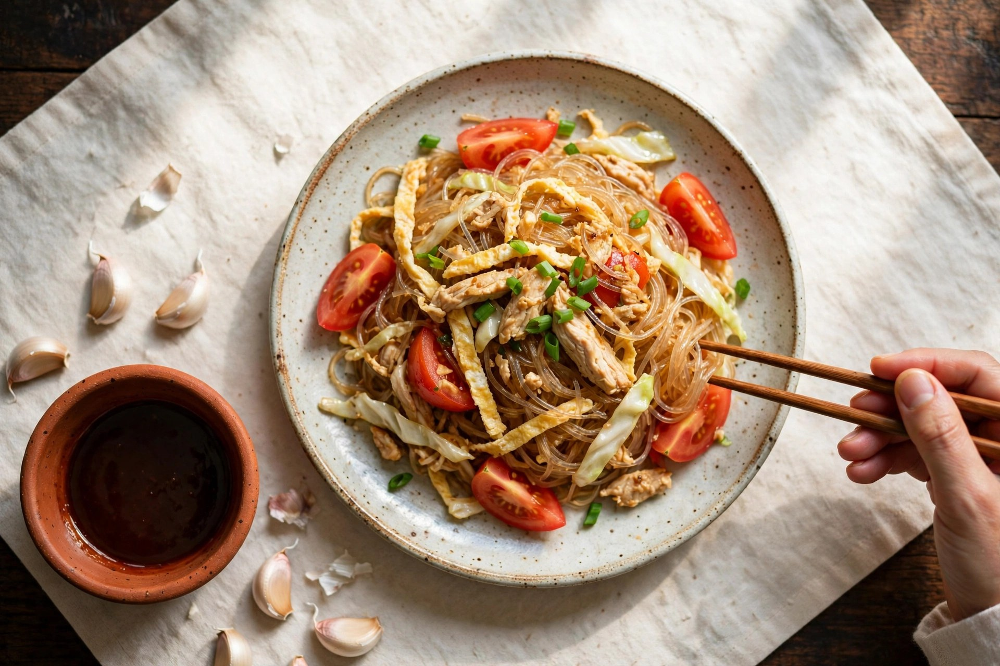
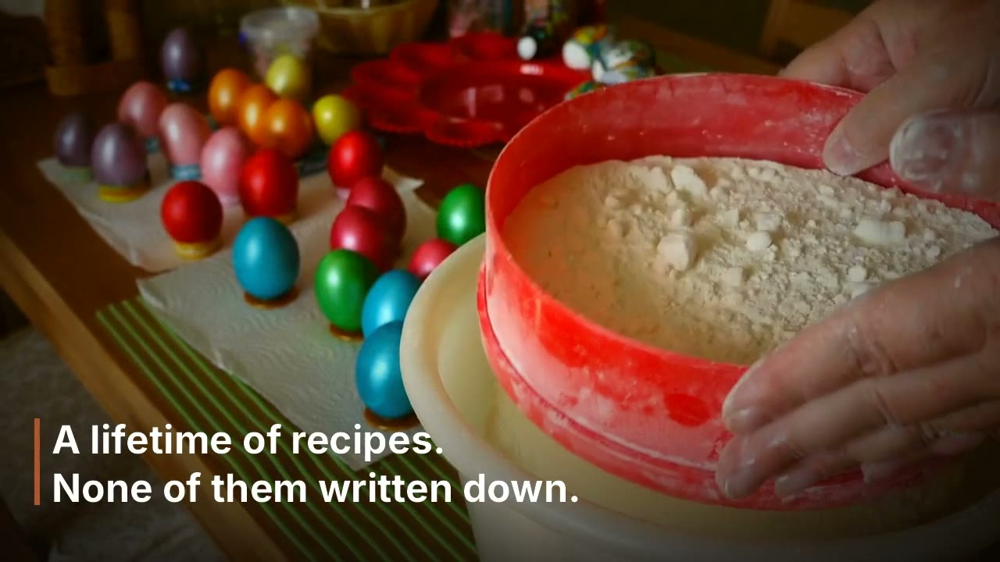
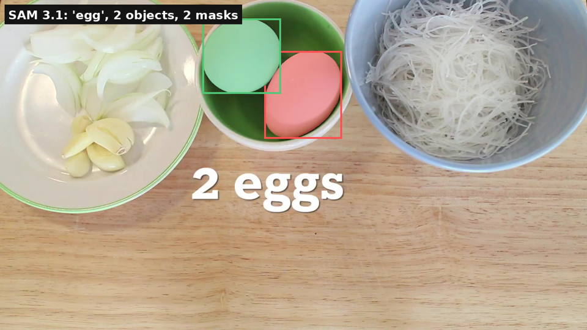

<p align="center">
  
</p>

# By Eye

**Take a photo of the plate. By Eye finds everything on it, amounts included.**

Tagline: measured from her hands.

Some cooks never measure anything. Flour goes in until it feels right, sauce until it tastes right, and the recipe lives in their hands and nowhere else. By Eye watches food the way that cook made it, finds every ingredient, estimates how much of each one there is, and shows its working for every single amount. No scales, no measuring cups, no guessing dressed up as fact: each number arrives with the evidence behind it and an honest range around it.

Pre-existing vs built this week: nothing in this repo predates the event. The concept and design notes were written before the build window; every line of code, data, and documentation in this repository was built this week, during the event period (Oct 27 to Nov 4, 2026).

## Watch it

[](docs/assets/by-eye-ad.mp4)

The 45 second film (MP4, in this repo). Below: a real frame from a real cooking video after the segmentation pass. SAM 3.1 found both eggs and outlined them; that outline is the measurement evidence the amount on the card points back to.



## What it does

**Plate scan.** Point a camera at a finished plate. By Eye names what is on it and estimates the amount of each item, with the segmented outline of every item kept as evidence you can look at yourself.

**Recipe reconstruction.** Film someone cooking, the way people already film family recipes on their phones. By Eye samples the footage into frames, reads each ingredient as it appears, listens to the cook's narration, and writes the recipe card that cook never wrote: amounts with ranges, steps in order, and the cook's own phrases kept word for word wherever a number would be a lie. The card is the artifact: printable, shareable, written to be cooked from by the next generation.

**Evidence, not vibes.** Every amount carries three things: the frame it was measured from, the measurement behind it (a segmentation mask and its coverage, a known-size object in frame as a size anchor, a density table turning volume into grams), and an approximation band. An adversarial pass then attacks each amount: anything with no anchor and no evidence frame is struck off the card and demoted to the cook's own words. If By Eye cannot prove a number, it does not print the number.

## Accuracy, stated honestly

The test dish is a real, unscripted cooking video: Pad Woon Sen (glass noodle stir fry), scored against the creator's published recipe card. Latest run (run 3, 2026-10-29), on 21 frames sampled from the footage:

- 21 amounts read, 19 scored against the published recipe
- 16 of 19 scored amounts within plus or minus 25 percent of the truth
- 17 of 19 approximation bands contain the truth
- Mean absolute error 7.1 percent across the scored amounts
- Exact reads include the 170 g of chicken, the glass noodles, the garlic, both sauces after unit conversion
- SAM 3.1 produced a usable mask on 6 of 21 frames; on the rest, the read stands on the frame and the anchors alone, and the card says so

What still misses, named plainly: the reader sometimes drifts to a neighbouring ingredient on a crowded board, which is why the oyster sauce and the chicken marinade are still unread despite having frames. The wok egg read came in at half (1 egg against 2). Green onion read 0.5 against 1. Sugar read a third low, inside its band, and was struck from the card as too weak. Water never appears on camera in this footage, so By Eye does not invent it. An early run also produced a famous failure, counting wok onion slices as 22 whole onions; the reader rules now forbid counting pieces as whole items, and the evaluator reports unit mismatches instead of scoring them as numbers.

On controlled test dishes whose frames print their values, the same pipeline reads 16 of 16 amounts inside the bar (MAE 0.1 percent, dish 1) and 10 of 10 (MAE 0.0 percent, dish 2). Those runs measure extraction reliability, not raw-footage estimation, and are reported separately for exactly that reason. Full run records, including the failures, live in the project's run summaries; nothing is rounded in the product's favour.

## Built on Meta AI

By Eye is built on the hosted Meta Model API, model by model, each doing the job it is good at:

| Meta model | What it does in By Eye |
|---|---|
| SAM 3.1 | Segments every frame. Its boxes and mask coverage are the measurement evidence attached to each amount. A no-match is recorded as a no-match, never hidden. |
| Muse Spark 1.3 | Reads each frame: which ingredient, what vessel, how full, pour start and stop. One call per frame, with the SAM evidence in the prompt. |
| Muse Voice Transcribe | Turns the cook's narration into text, so her own phrases can be kept verbatim on the card next to the measured amounts. |
| Muse Image 1.0 | Card and cover art, including the banner at the top of this page. |

Other client modes ship in the same interface (a deterministic stub for offline work, and a Baseten route for Muse Spark Open), but the Meta route is the product path and the one every number above came from.

## Quick start

Python 3.11 or newer, no third-party dependencies for the core pipeline.

```sh
git clone https://github.com/Dextheking1/by-eye.git
cd by-eye
python -m venv .venv
.venv/bin/pip install -e .
```

Stub mode (no API key needed, deterministic sample estimate):

```sh
.venv/bin/python -m by_eye.cli run --mode stub --out out/estimate.json
.venv/bin/python -m by_eye.cli evaluate --estimate out/estimate.json
```

Meta mode (hosted Meta Model API): put the key in `~/workspace/free-tiers/keys.env` as `META_API_KEY`, then:

```sh
.venv/bin/python -m by_eye.cli run --mode meta --frames path/to/frames_dir --out out/estimate.json
.venv/bin/python -m by_eye.cli evaluate --estimate out/estimate.json
```

Narration: Muse Voice Transcribe turns the cook's narration (WAV, mono 16-bit PCM) into the phrases the card keeps verbatim. Attach it to a run, or transcribe on its own:

```sh
.venv/bin/python -m by_eye.cli run --mode meta --frames path/to/frames_dir --narration narration.wav --out out/estimate.json
.venv/bin/python -m by_eye.cli transcribe --audio narration.wav --out out/transcript.json
```

The SAM mask decoder uses the optional `meta-sam-parser` package when installed (`pip install meta-sam-parser`); without it, SAM boxes still land as evidence and mask areas are reported as undecodable instead of guessed.

Tests: 34 of 34 passing.

```sh
.venv/bin/python -m pytest tests/ -q
```

## How it works

1. **Frames in.** Video is sampled into frames and scene segments.
2. **Segment.** SAM 3.1 outlines every ingredient it can find in each frame; boxes and mask coverage become evidence.
3. **Read.** Muse Spark 1.3 reads each frame with that evidence in view: ingredient, vessel, fill level, pour start and stop. A known-size anchor in frame (a hand, a standard mug) converts pixels to physical size; a small density table converts volume to grams.
4. **Estimate out.** Each amount leaves with its anchor chain and an approximation band. The adversarial strike pass demotes anything it cannot support.
5. **Score.** Estimates are compared against a weighed or published ground truth, per ingredient, as percentage error, with the band checked for honesty: the band should contain the truth.

| File | Role |
|---|---|
| `src/by_eye/frames.py` | Frame sampling and segmentation interface |
| `src/by_eye/clients.py` | Model client layer: stub, Baseten, generic OpenAI-compatible, and the hosted Meta Model API client (SAM 3.1 evidence, Muse Spark 1.3 reads, Muse Voice transcription, Muse Image) behind one interface |
| `src/by_eye/measure.py` | Anchors, density table, band logic |
| `src/by_eye/estimate.py` | Estimate schema and recipe card assembly |
| `src/by_eye/evaluate.py` | Per-ingredient scoring against ground truth, with unit conversion and ingredient matching |
| `src/by_eye/cli.py` | Command line entry point |
| `data/ground_truth_pad_woon_sen.json` | The published recipe amounts, the scoring target |
| `examples/sample_estimate.json` | The sample estimate the stub produces |

## Test dish and credits

The ground-truth test target is Pailin Chongchitnant's Pad Woon Sen (glass noodle stir fry), Hot Thai Kitchen.

- Video: https://www.youtube.com/watch?v=Amd2NR0n0WQ
- Ground truth recipe: https://hot-thai-kitchen.com/glass-noodle-stir-fry/ (the recipe page for that exact video), stored in `data/ground_truth_pad_woon_sen.json`
- Success bar: main ingredient amounts within about plus or minus 25 percent, with honest bands that contain the truth. Where the bar fails, bands widen and the cook's phrases carry the recipe instead of a number.

Note: the video and recipe are the creator's work. Permission from the creator is required before any public or demo use of the footage. In this repo the video is a reference link only; the pipeline runs on the published recipe data and on stills the project has the rights to use.

Built by Benjamin Kincses (Dextheking1). The banner art at the top was generated with Muse Image 1.0 through the project's own Meta route. The film's footage is licensed stock; no creator footage is redistributed.

## Roadmap

- **The app.** Plate scan as the front door: one photo of a finished plate, the analysis drawn over it, amounts and evidence a tap away. The pipeline in this repo is the engine; the phone is the interface being built now.
- **Cook corrections.** The cook confirms or fixes each amount on the card; corrections feed back into the bands, so a family's card gets more accurate every time it is cooked from.
- **A family library.** Cards saved per cook and per dish, printable and shareable, so a recipe survives the hands that invented it.
- **More cuisines, more anchors.** A wider anchor and density library, tested the same way this dish was: real footage, published ground truth, failures printed next to the wins.

## License

No license file ships with this repository yet; all rights are reserved by the author until one is chosen. Ask before reusing the code or the assets.
